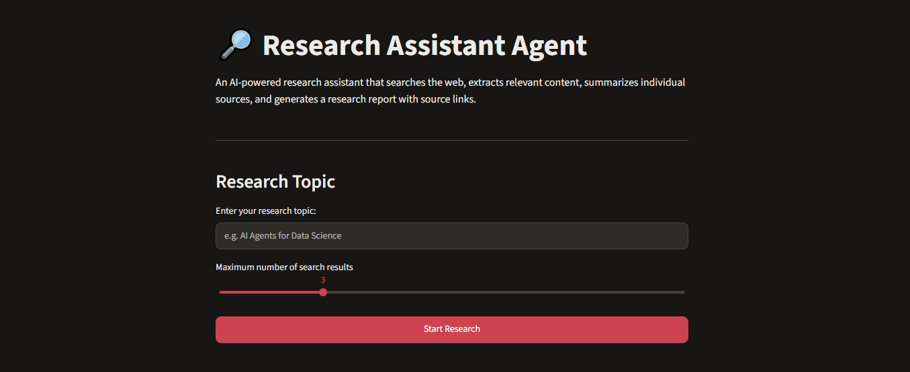

# Research Assistant Agent

An AI-powered research assistant that automates web research by searching the web, extracting relevant content, summarizing individual sources, and generating a structured research report with source links.

## Application Screenshot



## Features

- **Web Search:** Find relevant web pages using DuckDuckGo Search.
- **Content Extraction:** Extract the main text from web pages using Trafilatura.
- **Source Summarization:** Summarize individual sources using a local Large Language Model (LLM).
- **Research Report Generation:** Generate a structured report based on the collected source summaries.
- **Source References:** Display links to the original research sources.
- **Interactive Interface:** Run the research workflow through a Streamlit web application.

## Technologies

- Python
- Streamlit
- Ollama
- Qwen 2.5 (0.5B)
- DDGS
- Trafilatura
- Requests

## Project Architecture

The application follows a sequential research workflow:

1. The user enters a research topic.
2. DDGS searches the web for relevant pages.
3. Trafilatura extracts the main content from each page.
4. The local Qwen model summarizes each successfully extracted source.
5. The summaries are combined and sent to the LLM to generate a research report.
6. Streamlit displays the final report and original source links.

## Project Structure

```text
research-assistant-agent/
│
├── app.py
├── agent.py
├── tools.py
├── requirements.txt
├── .gitignore
└── README.md
```

## Installation

### 1. Clone the Repository

```bash
git clone https://github.com/bankehsaz/research-assistant-agent.git
cd research-assistant-agent
```

### 2. Create a Virtual Environment

```bash
python -m venv .venv
```

Activate the environment:

**Windows (PowerShell):**

```powershell
.venv\Scripts\Activate.ps1
```

### 3. Install Dependencies

```bash
pip install -r requirements.txt
```

### 4. Install Ollama

Download and install Ollama from:

https://ollama.com/

Pull the required model:

```bash
ollama pull qwen2.5:0.5b
```

Make sure the Ollama service is running before starting the application.

## Usage

Run the Streamlit application:

```bash
streamlit run app.py
```

Open the local URL displayed in the terminal, enter a research topic, select the maximum number of search results, and click **Start Research**.

## Limitations

- Some websites may block automated content extraction or return incomplete content.
- Research quality depends on the availability and quality of extracted sources.
- The local language model has limited capabilities, which may affect summary accuracy and report quality.
- The application does not guarantee that all generated information is factually correct. Research findings should be verified against the original sources.

## Future Improvements

- Support for more capable language models.
- Improved source extraction and error handling.
- Enhanced research report quality and source verification.
